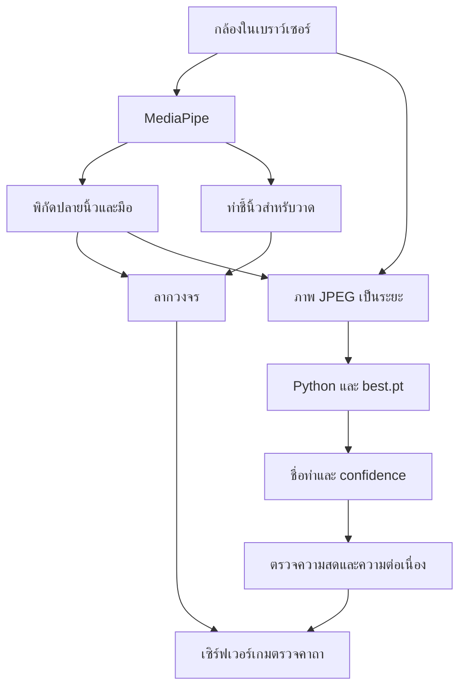

> ARCHIVE — เอกสารของเกมคาถารุ่น 2.x เก็บเพื่ออ้างอิงโค้ดเดิม กติกาหน้าเว็บปัจจุบันเปลี่ยนเป็น ASL แล้ว โปรดเริ่มที่ README.md และ ASL-SETUP-TH.md

# นำโมเดล .pt ของคุณมาใช้กับ SANZARU 2.2

คู่มือนี้ใช้กับชุดโค้ด SANZARU ที่เพิ่ม Python AI API แล้ว
คุณยังไม่ได้ส่งไฟล์โมเดลจริงมา จึงไม่มี best.pt ของคุณใน ZIP และยังไม่ได้วัดความแม่นยำของมัน
ตัวเชื่อมรองรับ **Ultralytics YOLO task detect และ classify** ไม่ใช่ทุกไฟล์ที่นามสกุล .pt

## 1. ต้องเข้าใจก่อนว่า .pt คืออะไร

ไฟล์ .pt เป็นไฟล์ที่มักใช้เก็บข้อมูลของ PyTorch แต่ไม่ได้มีรูปแบบเดียวทั้งหมด
อาจเป็น weights/state_dict, checkpoint ที่มีโครงสร้างโมเดล, TorchScript หรือ checkpoint ของ framework เฉพาะ
จึงดูแค่นามสกุลแล้วสรุปว่าโหลดด้วย YOLO() ได้ทันทีไม่ได้

| คุณได้โมเดลมาจากไหน/เป็นอะไร | วิธีใช้กับไฟล์ชุดนี้ |
|---|---|
| ฝึกด้วย Ultralytics YOLOv8/YOLO11 และได้ best.pt แบบ detect/classify | เป็นเส้นทางที่ตัวเชื่อมเตรียมรองรับ ใช้ dependencies ที่เข้ากันกับรุ่นที่ฝึก |
| Roboflow ใช้จัด dataset แล้ว export ไป train ด้วย Ultralytics | ใช้ตาม checkpoint ของ Ultralytics ไม่ต้องมี Roboflow API key สำหรับการรัน local นี้ |
| Roboflow Hosted Model/Workflow | ตรวจ format และวิธี inference ของโมเดลนั้น ไม่ใช่ทุกบริการจะให้ checkpoint ที่โหลดด้วย YOLO() ได้ |
| PyTorch state_dict ที่เขียนโมเดลเอง | ต้องมี class architecture, preprocessing และชื่อคลาส แล้วปรับ predictor.py |
| โมเดล YOLOv5 รุ่นเดิมจาก repo YOLOv5 | loader อาจต่างจาก Ultralytics package รุ่นปัจจุบัน ต้องใช้ adapter/dependencies ของรุ่นนั้น |
| YOLO pose/keypoint | ได้จุดร่างกาย ไม่ใช่คำตอบชื่อท่าร่ายโดยอัตโนมัติ ต้องมี logic/classifier แปลงจุดเป็นท่าก่อน |
| โมเดลท่าที่ต้องดูการเคลื่อนไหวหลายเฟรม | ต้องมี temporal model/sequence buffer เพิ่ม ตัวเชื่อมนี้ประเมินภาพทีละเฟรม |

ใช้ checkpoint ที่คุณฝึกเองหรือเชื่อถือได้ เพราะการโหลดไฟล์โมเดลบางรูปแบบอาจรันโค้ดจากไฟล์ได้
ไม่จำเป็นต้องนำโมเดลขึ้น Roboflow อีกรอบถ้ามี checkpoint ของ Ultralytics ที่ใช้งานได้อยู่แล้ว

## 2. ในเกมมีงาน AI สองอย่าง

### ติดตามปลายนิ้วเพื่อวาด

MediaPipe เดิมตรวจมือและ landmarks ตำแหน่งนิ้วชี้ใช้ landmark 8
เกมแปลงพิกัดให้ตรงกับภาพแบบกระจก และตรวจว่าปลายนิ้วผ่านจุดวงจรตามลำดับหรือไม่
การตรวจลำดับจุด/เส้นทางเป็นกฎของเกม ไม่ใช่การเอาภาพวงคาถาทั้งภาพไปจำแนก

Bounding box ของมือจาก object detection ไม่ใช่ตำแหน่งปลายนิ้วที่แม่นพอจะใช้แทน landmark โดยตรง
ดังนั้นรุ่นนี้คง MediaPipe สำหรับการติดตามนิ้วและท่า Pointing_Up เอาไว้

### จำแนกท่าปิดผนึก

เมื่อหยุดลากแล้ว ผู้เล่นทำท่ามือ โมเดล .pt ของคุณจะรับภาพและคืนชื่อคลาสพร้อม confidence
ระบบแปลงชื่อคลาสเป็น ID ของเกม แล้วตรวจความต่อเนื่องของท่าก่อนนับการค้าง
เกมยังตรวจวงจร ท่า และเวลาในเซิร์ฟเวอร์เกมตามกติกาเดิม



รูปแบบนี้เป็น hybrid: นิ้วเคลื่อนที่ได้ต่อเนื่องในเครื่อง โดยไม่ต้องรอเครือข่ายทุกครั้งที่ลาก
ผล .pt มีหน้าที่เลือกท่าปิดผนึกเท่านั้น ไม่ได้แทนระบบลากวงจรทั้งหมด

## 3. ทางเลือกทั้งหมดที่เกี่ยวข้อง

| วิธี | รันโมเดลที่ไหน | ใช้ .pt โดยตรงไหม | สถานะในโค้ดที่ส่ง |
|---|---|---|---|
| Python + Ultralytics + FastAPI | PC/Pi/เซิร์ฟเวอร์ของคุณ | ใช่ ถ้าเป็น checkpoint ที่รองรับ | เชื่อมกับหน้าเกมแล้ว |
| Export ONNX + ONNX Runtime Web | เบราว์เซอร์ของผู้เล่น | ต้องแปลง | มี script export; ยังไม่มี browser adapter สำหรับโมเดลที่ไม่ทราบรูปแบบ |
| Export ONNX + runtime ฝั่ง server | PC/เซิร์ฟเวอร์ | ต้องแปลง | เป็นทางต่อยอดของ predictor.py |
| TensorFlow/LiteRT/TF.js ตามรุ่นที่รองรับ | Browser/runtime ที่รองรับ | ต้องแปลงและทำ adapter | ไม่ได้เชื่อมในรุ่นนี้ |
| Hosted inference เช่นบริการของ Roboflow | เซิร์ฟเวอร์ผู้ให้บริการ | ขึ้นกับบริการและโมเดล | ต้องเปลี่ยน client/proxy ตาม API ของบริการ |

สำหรับการเริ่มใช้ best.pt ที่มีอยู่ แนะนำเส้นทาง Python ที่เตรียมไว้ก่อน
ถ้าเป้าหมายต่อไปคือทุกคนเปิดเว็บแล้วเล่นได้โดยไม่มี AI server แยก จึงค่อยทำ ONNX browser adapter

## 4. ต้องวางไฟล์ตรงไหน

วางโมเดลของคุณที่ **ai-server/models/best.pt**
ชื่อไฟล์ best.pt ต้องตรงจริง ระวัง Windows ซ่อนนามสกุลจนกลายเป็น best.pt.pt
โฟลเดอร์นี้มี PUT-YOUR-MODEL-HERE.txt เป็นคำแนะนำ ไม่ใช่โมเดลจำลอง

| ตำแหน่ง | หน้าที่ |
|---|---|
| ai-server/models/best.pt | โมเดลของคุณ — ต้องนำมาใส่เอง |
| ai-server/model-config.json | path, ขนาดภาพ, confidence, device, วิธีครอบภาพ และตารางชื่อคลาส |
| ai-server/predictor.py | จุดที่โหลด YOLO และอ่าน boxes/probs; เปลี่ยนตรงนี้ถ้าโมเดลเป็น framework อื่น |
| ai-server/core.py | ตรวจ config, จับคู่กรอบมือ และแปลงคลาสเป็นท่าของเกม |
| ai-server/app.py | FastAPI: GET /health และ POST /predict |
| ai-server/inspect_model.py | ดู task/ชื่อคลาส/ท่าที่ยังขาดของโมเดล |
| ai-server/export_onnx.py | ตัวช่วย export เท่านั้น ไม่ใช่ตัวเชื่อม ONNX browser ที่เสร็จแล้ว |
| app/custom-gesture-client.ts | จับภาพจาก video เป็น JPEG และเรียก AI API |
| app/use-hand-camera.ts | รวม MediaPipe กับผลจากโมเดลของคุณ |
| lib/gesture-inference.ts | สัญญา JSON, กรองท่า, ตรวจเวลาภาพและพิกัดมือ |
| app/ritual/model-settings.tsx | ช่องเลือกโมเดล, URL, token และปุ่มตรวจการเชื่อมต่อ |
| app/ritual/circuit.tsx | ลากวงคาถา ค้างท่า และส่ง cast |
| lib/ritual-shared.ts | ID/ชื่อ/คำใบ้ของท่าที่เกมรองรับ |
| lib/ritual-engine.ts | สุ่มสูตรและตรวจคาถาที่ผู้เล่นส่ง |

ไม่ใส่ .pt ใน public/vision/ และไม่เปลี่ยนนามสกุลเป็น .task
ไฟล์ gesture_recognizer.task ของ MediaPipe ยังจำเป็นต่อระบบติดตามมือ
ไม่ใส่ .pt ในไฟล์ TSX และไม่ต้อง import มันเข้า React

## 5. ตรวจชื่อคลาสให้ตรงกับเกม

เกมปัจจุบันสุ่มท่าปิดผนึก 4 แบบ ส่วนท่าชี้นิ้วใช้ MediaPipe:

| ท่าจริง | ID ที่เกมรับ | ตัวอย่างชื่อคลาสของโมเดล |
|---|---|---|
| กำมือ | Closed_Fist | fist หรือ Closed_Fist |
| แบมือ | Open_Palm | palm หรือ Open_Palm |
| ชูสองนิ้ว | Victory | victory หรือ Victory |
| ยกนิ้วโป้ง | Thumb_Up | thumb_up หรือ Thumb_Up |
| มือพัก/ท่าที่ไม่ใช่คาถา | None | neutral หรือ background |
| ชี้นิ้วลากวงจร | Pointing_Up | ใช้ MediaPipe ไม่ต้องมีใน .pt |

แก้ **class_map** ใน model-config.json ให้ฝั่งซ้ายตรงกับชื่อคลาสใน model.names แบบตัวพิมพ์เล็ก/ใหญ่ตรงกัน
ฝั่งขวาคือ ID คงที่ของเกม ตัวอย่าง:

```json
"class_map": {
  "my_fist": "Closed_Fist",
  "my_open_hand": "Open_Palm",
  "two_fingers": "Victory",
  "thumbs_up": "Thumb_Up",
  "not_casting": "None"
}
```

นี่เป็นส่วนหนึ่งของ JSON ให้แทนที่ class_map เดิม ไม่ใช่แทนที่ทั้งไฟล์
หาก model.names มีคลาสชื่ออื่น เช่น hand_1 ต้องรู้ว่าหมายถึงท่าอะไร ไม่เดาจากหมายเลขคลาส
ระบบไม่ผูกกับ class 0/1/2/3 จึงไม่พังเพราะลำดับคลาสเปลี่ยน แต่ชื่อและความหมายต้องตรง

หากโมเดลมีท่าปิดผนึกเพียง 2 แบบ รุ่นนี้จะแจ้งว่าขาดอีก 2 แบบและไม่ยืนยันว่าพร้อมเล่น
เพราะสูตรเกมยังสุ่มทั้ง 4 แบบ ทางเลือกคือฝึกให้ครบ หรือแก้รายการ GESTURES/สูตร/หน้าตำรา/ตัวตรวจ coverage ให้รองรับชุดท่าใหม่พร้อมกัน
ไม่ควร map ท่าเดียวเป็นทุกคาถา เพราะจะทำให้ทายทุกสูตรได้ด้วยท่าเดียว

หากใช้ท่าใหม่จริง ๆ เช่นท่ามังกร ไม่ใช่แค่เปลี่ยนชื่อกำมือ:
ต้องแก้ชื่อ คำใบ้ สัญลักษณ์ใน GESTURES และข้อความใน use-hand-camera.ts ให้ตรงกับท่าจริง
หากเพิ่ม ID ใหม่ ต้องปรับตัวตรวจใน frontend/backend, SEALS ใน Python, สูตรสุ่ม และ tests ด้วย
ตัวเชื่อมนี้ยังไม่ได้เพิ่มเกมแบบสองมือหรือจำแนกท่าทั้งตัวให้โดยอัตโนมัติ

## 6. ตั้งค่าภาพให้เหมือนตอน train

ตัวเลือกใน model-config.json:

| คีย์ | ค่าเริ่มต้น | ควรตั้งอย่างไร |
|---|---|---|
| model_path | models/best.pt | relative กับโฟลเดอร์ที่เก็บ config หรือ absolute path ของเครื่อง server |
| image_size | 640 | เริ่มจากขนาดที่ฝึก เช่น detect 640, classify 224; รุ่นนี้รับ 128–1280 และหาร 32 ลงตัว |
| confidence | 0.65 | เกณฑ์เริ่มต้นที่ต้องทดสอบจริง ไม่ใช่ accuracy 65%; รุ่นนี้รับ 0.60–1.00 |
| iou | 0.45 | threshold สำหรับ detector; ไม่ใช่เกณฑ์ถูก/ผิดของท่าร่าย |
| device | cpu | เริ่มจาก CPU; ใช้ 0 หรือ "0" สำหรับ CUDA GPU เมื่อ environment รองรับ |
| input_mode | full-frame | ภาพเต็มกล้อง; ใช้ hand-crop ถ้าฝึกจากภาพมือครอบไว้ |
| association_overlap | 0.25 | detector ต้องทับกับมือที่ MediaPipe ติดตาม คิดจาก intersection/พื้นที่กรอบที่เล็กกว่า ไม่ใช่ IoU |

Object detection โดยทั่วไปส่งภาพเต็มเฟรม แล้วเลือก detection ที่ซ้อนกับมือที่กำลังควบคุมเกม
หากพบหลายกรอบ จะพิจารณาคะแนนสูงสุดในกลุ่มที่ตรงกับมือ ไม่เลือกมืออีกคนที่อยู่ไกลออกไป
กรณีกรอบซ้อนกันมากยังแยกได้ไม่สมบูรณ์ ควรให้ผู้เล่นคนเดียวอยู่หน้ากล้อง

Classification ให้ดูข้อมูลที่ฝึก:

- ถ้าฝึกจากภาพมือที่ครอบใกล้ ๆ ใช้ hand-crop เพื่อลดความต่างของข้อมูลเข้า
- ถ้าฝึกจากภาพกล้องทั้งภาพ ใช้ full-frame แล้วทดสอบพื้นหลังและระยะให้ตรง
- โมเดล classification อาจเลือกหนึ่งในคลาสคาถาแม้กำลังพักมือ ควรมี neutral/other และตัวอย่างช่วงเปลี่ยนท่า
- ช่วง pointing_up ต้องไม่ถูกสอนให้เป็นท่าปิดผนึก
- รูปที่ส่งเข้า Python เป็นภาพดิบไม่กลับซ้ายขวา แม้ preview จะแสดงแบบกระจก
- หากฝึกด้วย custom transforms ต้องใช้ preprocessing ที่สอดคล้องใน predictor.py

ภาพส่งออกจากเว็บมีด้านยาวไม่เกิน 640 px, JPEG quality 0.78
ค่า image_size ที่สูงกว่า 640 ใน Python จะเป็นการ rescale ไม่ได้เพิ่มรายละเอียดกล้อง
ถ้าต้องการรายละเอียดมากกว่านี้จริง ต้องแก้ขนาด capture ใน custom-gesture-client.ts และทดสอบเวลาใหม่

## 7. เริ่ม AI server บน Windows

แนะนำ Python รุ่นที่เข้ากันกับ environment ตอน train เช่น Python 3.11/3.12
หากมี environment ที่รัน best.pt ได้อยู่แล้ว ใช้อันนั้นและติดตั้ง FastAPI/Uvicorn เพิ่มได้

เปิด PowerShell ในโฟลเดอร์ **portal-panic-source/ai-server** แล้วรันทีละคำสั่ง:

```powershell
py -3.11 -m venv .venv
.\.venv\Scripts\python.exe -m pip install --upgrade pip
.\.venv\Scripts\python.exe -m pip install -r requirements.txt
.\.venv\Scripts\python.exe inspect_model.py
.\.venv\Scripts\python.exe -m uvicorn app:app --host 127.0.0.1 --port 8001 --workers 1
```

ถ้าใช้ Python 3.12 ที่ติดตั้งไว้ เปลี่ยนคำสั่งแรกเป็น py -3.12
เรียก python.exe ใน venv ตรง ๆ แบบนี้ไม่ต้องเปลี่ยน PowerShell execution policy
ต้องวาง best.pt และแก้ class_map ก่อนเรียก inspect_model.py

หากโหลดโมเดลไม่ได้เพราะ version ให้ใช้ Ultralytics/PyTorch เวอร์ชันเดียวกับตอน train ก่อน
requirements.txt กำหนดช่วงความเข้ากันได้ ไม่ใช่การรับประกัน checkpoint ทุกเวอร์ชัน
เมื่อทดสอบกับโมเดลจริงผ่านแล้ว บันทึก environment ที่ใช้งานได้ด้วย:

```powershell
.\.venv\Scripts\python.exe -m pip freeze > requirements-working.txt
```

อย่าเพิ่ม --reload ระหว่างเล่นจริง เพราะการ reload จะทิ้งสถานะและโหลดโมเดลใหม่
ใช้ --workers 1 สำหรับรุ่นนี้ เพื่อใช้โมเดลชุดเดียวและไม่คัดลอกหน่วยความจำ GPU หลายชุด

## 8. macOS / Linux / Raspberry Pi

เปิด Terminal ใน ai-server:

```bash
python3 -m venv .venv
.venv/bin/python -m pip install --upgrade pip
.venv/bin/python -m pip install -r requirements.txt
.venv/bin/python inspect_model.py
.venv/bin/python -m uvicorn app:app --host 127.0.0.1 --port 8001 --workers 1
```

Raspberry Pi ต้องมี Python/PyTorch ที่รองรับระบบและสถาปัตยกรรมของเครื่อง
การติดตั้งและความเร็วบน Pi ยังไม่ได้ทดสอบกับไฟล์นี้ ถ้า inference ช้าจนเกินเกณฑ์ เกมจะไม่นับผลภาพเก่า
เริ่มทดสอบบน PC ก่อน แล้วค่อยลองโมเดลเล็กลง/ขนาดภาพต่ำลงหรือ export ที่เหมาะกับ Pi
อย่าคาดหวังความเร็วเท่า PC เพียงเพราะไฟล์โหลดได้

## 9. เปิดเว็บและเลือกโมเดล

เปิด Terminal อีกหน้าต่างในโฟลเดอร์ **portal-panic-source**:

```bash
pnpm install --frozen-lockfile
pnpm setup:local
pnpm start
```

ถ้าติดตั้ง/ตั้งฐานข้อมูลไว้แล้ว ใช้ pnpm build และ pnpm start ตาม README
เปิด http://localhost:8787/play แล้ว:

1. เลือกคิคาซารุ (คนร่าย)
2. เลือกโหมดกล้อง
3. ในช่อง “โมเดลท่าปิดผนึก” เลือก “โมเดล .pt ของฉัน”
4. ใส่ URL http://127.0.0.1:8001
5. ใส่ API token เฉพาะกรณีที่ตั้ง AI_API_TOKEN ไว้ใน Python
6. กด “ตรวจการเชื่อมต่อและชื่อคลาส” ต้องแจ้งว่าครบ 4 ท่า
7. อ่านข้อความแจ้งการส่งภาพ แล้วกดเปิดกล้อง
8. ชูมือ ทดสอบชื่อท่าทีละแบบ ดูชื่อคลาสและเวลาไปกลับที่แสดง
9. ชวนเพื่อนเข้าห้อง กดพร้อม และทดลองร่ายหนึ่งผนึก

ในโหมด custom กล้องส่งภาพให้ AI API ที่คุณเลือก ไม่ใช่การประมวลผลทั้งหมดใน browser
API ตัวอย่างนี้ไม่บันทึกภาพลงดิสก์ แต่ควรตรวจระบบ proxy/logging ของโฮสต์ที่คุณนำไปใช้ด้วย
ไม่ส่งภาพให้เพื่อนในเกม และไม่เปิดกล้องจาก Python ด้วย cv2.VideoCapture
ภาพของผู้เล่นมาจากเบราว์เซอร์ ไม่ใช่ webcam ของเครื่องที่รัน server

เลือกกลับ MediaPipe เดิมได้เมื่อปิดกล้องแล้ว โหมดเดิมไม่ต้องเปิด Python service
เกมจะไม่เปลี่ยนกลับไปใช้ MediaPipe ปิดผนึกแบบเงียบ ๆ หาก custom API ล่ม
เพื่อให้ผลที่นำเสนอว่าใช้โมเดลของคุณเป็นผลจากโมเดลของคุณจริง

## 10. localhost และการเล่นข้ามเครื่อง

มีเซิร์ฟเวอร์สองหน้าที่:

- **Game server**: ห้อง 3 คน ข้อความ เวลา สูตร และคะแนน
- **AI server**: รับภาพจากคนร่ายและทำนายท่า

ทั้งสองอาจรันบน PC เครื่องเดียวกัน แต่เป็นคนละ process และคนละ port
เช่น เกม :8787 และ AI :8001

localhost/127.0.0.1 หมายถึงเครื่องที่กำลังเปิดเบราว์เซอร์ ไม่ใช่คอมของเจ้าของห้อง
เพื่อนจะใช้ http://127.0.0.1:8001 ของคุณไม่ได้ เว้นแต่เปิด Python บนเครื่องของเพื่อนเอง

ทางเลือกเล่นออนไลน์:

1. ทุกเครื่องที่จะเป็นคนร่ายรัน AI server local ของตัวเอง: เหมาะทดลองในเครื่อง แต่เมื่อเว็บใช้ HTTPS ต้องจัด HTTPS ให้ API ตามกติกา client นี้ด้วย
2. ใช้ AI server กลางที่ทุกเครื่องเข้าถึงผ่าน HTTPS: คนร่ายส่งภาพเข้า server นั้น อีกสองบทบาทไม่ต้องเปิดกล้อง
3. ต่อไปทำ ONNX browser adapter: ลดความจำเป็นต้องมี AI server แต่ต้องตรวจโมเดลและเขียนตัวอ่านผลให้ครบก่อน

สำหรับ shared server ให้ตั้ง ALLOWED_ORIGINS เป็น origin ของหน้าเกมจริง เช่น https://game.example.org
origin มี protocol + host + port ไม่มี /play ต่อท้าย
หากต้องการ bind ออก LAN ใช้ --host 0.0.0.0 แต่ URL ที่เปิดจากเพื่อนต้องเป็น IP/domain ของเครื่อง
0.0.0.0 ไม่ใช่ URL ที่ให้ผู้เล่นใส่ และ HTTP LAN ทั่วไปยังมีข้อจำกัดเรื่องสิทธิ์กล้อง
เพื่อใช้งานผ่านเว็บ HTTPS ให้ใช้ AI API ที่มี HTTPS ด้วย เช่น reverse proxy หรือ tunnel ที่คุณตั้งเอง
โค้ด client รุ่นนี้ปฏิเสธ HTTP API เมื่อหน้าเว็บเปิดผ่าน HTTPS

ตัวอย่าง PowerShell ก่อนรัน Uvicorn บน shared server:

```powershell
$env:ALLOWED_ORIGINS="https://game.example.org"
$env:AI_API_TOKEN="replace-with-your-own-demo-access-token"
.\.venv\Scripts\python.exe -m uvicorn app:app --host 0.0.0.0 --port 8001 --workers 1
```

ตัวอย่าง Linux/macOS:

```bash
export ALLOWED_ORIGINS="https://game.example.org"
export AI_API_TOKEN="replace-with-your-own-demo-access-token"
.venv/bin/python -m uvicorn app:app --host 0.0.0.0 --port 8001 --workers 1
```

ข้อความ token ข้างต้นเป็นตัวอย่าง ต้องเปลี่ยนเอง ไม่ใช่ token ที่แถมให้
ช่อง token ในเว็บเก็บในหน่วยความจำ ไม่บันทึกใน localStorage และหายเมื่อ refresh
shared token สำหรับเดโมนี้ไม่ใช่ระบบสมาชิก/สิทธิ์แบบ production; ผู้ใช้ที่ได้รับ token ย่อมมองเห็นและใช้มันได้
อย่านำ private API key ของบริการที่คิดเงินมาใส่ใน frontend หากต้องใช้บริการนั้นให้มี server-side proxy ที่เหมาะสม

รุ่นนี้อนุญาตงาน inference ครั้งละหนึ่งงานต่อ process ถ้าหลายทีมส่งพร้อมกันจะได้ 503 busy และใช้เฟรมใหม่ลองอีกครั้ง
เหมาะเริ่มจากหนึ่งทีม ไม่ใช่การรับประกันรองรับทั้งชั้นเรียนพร้อมกัน
ยังไม่มีการ deploy AI server หรือเว็บใหม่ให้ในงานนี้

## 11. การกรองผลและการค้างท่า

1. ส่งภาพได้ไม่ถี่กว่า 200 ms ต่อคำขอ ตั้งเป้าสูงสุดประมาณ 5 ครั้ง/วินาที แต่ความเร็วจริงขึ้นกับเครื่อง
2. มีคำขอ inference ค้างได้ครั้งเดียว ไม่ต่อคิวภาพเก่า
3. คำขอ timeout ที่ 1.8 วินาที และการตรวจ health timeout ที่ 4 วินาที
4. นับอายุจากเวลาที่จับภาพ ไม่ใช่เวลาที่คำตอบมาถึง
5. ผลที่อายุเกิน 650 ms ไม่ถูกใช้เป็นท่าปิดผนึก
6. ต้องผ่าน confidence ที่กำหนดและสังเกตท่าเดียวกันต่อเนื่องอย่างน้อย 180 ms
7. เมื่อคลาสเปลี่ยน ความมั่นใจต่ำ มือหาย หรือผลเก่า ระบบปล่อย None แทนการค้างท่าเดิม
8. ในวงคาถา ท่าต้องถูกค้างประมาณ 850 ms ก่อนส่ง cast
9. เซิร์ฟเวอร์เกมตรวจเวลาค้างขั้นต่ำและสูตรเดิมอีกชั้น แต่ผล AI ยังเป็นข้อมูลที่ส่งจาก client ไม่ใช่ระบบกันโกงระดับแข่งขัน

ดังนั้นผู้เล่นอาจต้องถือท่านานกว่า 0.85 วินาทีรวมเวลารอโมเดลและทำให้ผลนิ่ง
ภาพทำนายเพียงครั้งเดียวที่ค้างอยู่จะไม่ถูกนับให้ผ่านการค้าง 850 ms
ถ้า inference ช้า ควรลด latency ก่อนเพิ่มอายุผล ไม่ยืด TTL จนภาพนิ่งเก่านับเป็นการร่ายได้

## 12. GPU และการปรับความเร็ว

- เริ่ม CPU เพื่อแยกปัญหาการเชื่อมต่อออกจากปัญหา CUDA
- ถ้ามี NVIDIA GPU และ PyTorch ที่รองรับ CUDA ตรวจ torch.cuda.is_available() ก่อนเปลี่ยน device เป็น 0
- ติดตั้ง PyTorch ตามตัวเลือกใน https://pytorch.org/get-started/locally/ ให้ตรงระบบ ไม่เดา CUDA จากชื่อ GPU อย่างเดียว
- โมเดล detection ลอง image_size 640 → 416 → 320 แล้วทดสอบความแม่นยำใหม่
- โมเดล classification ใช้ขนาดและ crop ที่สอดคล้องกับตอน train เช่น 224
- ดูค่า “AI ... ms” เทียบกับ “ไปกลับ ... ms”: ต่างกันมากอาจเสียเวลาที่จับภาพ ส่งข้อมูล หรือเครือข่าย
- จำนวน inference ที่มากขึ้นไม่ได้แก้โมเดลที่จำแนกผิด ต้องดู dataset และ confusion matrix ด้วย

## 13. ถ้าอยากรันทั้งหมดในเบราว์เซอร์

เส้นทาง ONNX ที่เตรียม script ให้:

```powershell
.\.venv\Scripts\python.exe export_onnx.py
```

หรือใน Python:

```python
from ultralytics import YOLO
model = YOLO("models/best.pt")
model.export(format="onnx", imgsz=640, dynamic=False, half=False, simplify=False, nms=False)
```

การ export อาจต้องติดตั้งแพ็กเกจ export เพิ่มตาม Ultralytics เวอร์ชันที่คุณใช้
ผลคือไฟล์ ONNX ไม่ใช่การเปลี่ยนแค่ชื่อ best.pt เป็น best.onnx
สำหรับ classification ใช้ imgsz ที่ตรงกับโมเดลของคุณ เช่น 224

หากจะเชื่อม browser ต้องทำต่ออย่างน้อย:

1. ติดตั้ง onnxruntime-web และจัดไฟล์ WASM/runtime ให้โหลดได้จากเว็บ
2. วางไฟล์ ONNX ในตำแหน่ง static เช่น public/models/gesture.onnx
3. ใช้ InferenceSession.create() เปิดโมเดล
4. ดู inputNames/outputNames, tensor shapes, dtype และ layout จริง
5. ทำ RGB normalization, resize/letterbox หรือ crop เหมือนตอน train/export
6. สร้าง tensor ที่ถูกต้อง เช่น [1,3,H,W] เฉพาะเมื่อโมเดลนั้นใช้ NCHW
7. อ่าน output ตามชนิดโมเดล: classification scores หรือ detection boxes/classes
8. ทำ NMS เฉพาะกรณีโมเดล/export นั้นยังต้องทำ และย้อน letterbox กลับพิกัดภาพ
9. map คลาสและใช้ timing/filter เหมือนทาง Python ก่อนส่งเข้ากติกาเกม
10. ทดสอบความเข้ากันได้ของ WebAssembly/WebGPU และเทียบผลกับ Python บนภาพชุดเดียวกัน

YOLO แต่ละรุ่น/การ export อาจให้ output ต่างกัน ไม่ควร hardcode เช่น [1,84,8400] กับทุกโมเดล
classification, legacy YOLOv5, YOLOv8/11 และรุ่นที่มี postprocessing ในกราฟไม่ได้แปล output แบบเดียวกันทั้งหมด
จึงยังไม่สร้าง browser decoder ที่แอบสมมติรูปร่าง tensor ของโมเดลที่คุณยังไม่ได้ส่งมา
ไฟล์ export_onnx.py ทำเฉพาะ export ส่วนเกมใน ZIP ใช้ Python API ที่เชื่อมไว้จริง

โมเดลที่เสิร์ฟเป็นไฟล์ public ใน browser สามารถถูกดาวน์โหลดโดยผู้ใช้ได้
ถ้าต้องเก็บ weights เป็นความลับ ควรประมวลผลบน server ที่คุณควบคุม
การเรียกชื่อ export "tfjs" ยังขึ้นกับ Ultralytics รุ่นที่ติดตั้ง ตรวจเอกสารของรุ่นนั้นก่อนใช้ตัวอย่างเก่า

## 14. ถ้า .pt เป็น PyTorch model ที่เขียนเอง

ตัวอย่างแนวทางใน predictor.py:

```python
import torch
from my_architecture import GestureNet

model = GestureNet(num_classes=5)
state = torch.load("models/best.pt", map_location="cpu", weights_only=True)
model.load_state_dict(state)  # หรือ state["model_state_dict"] ตาม format ตอน save
model.eval()

with torch.inference_mode():
    logits = model(input_tensor)  # ต้องสร้างด้วย preprocessing ของโมเดลจริง
    scores = torch.softmax(logits, dim=1)
```

นี่เป็นตัวอย่างการอ่าน state_dict ไม่ใช่โค้ดที่รู้ architecture/input ของคุณแล้ว
หาก model ให้ probabilities มาอยู่แล้ว ไม่ควรใส่ softmax ซ้ำโดยไม่ตรวจ output
adapter ใหม่ต้องมี task, names และ predict(PIL.Image) ที่คืนรายการ Prediction ตามสัญญาใน core.py
ถ้าเป็น detector ต้องคืน box แบบ normalized x1,y1,x2,y2 ในภาพที่ได้รับ

## 15. สัญญา API สำหรับ debug หรือเปลี่ยน backend

GET /health ตอบ protocol, ready, task, classes, mapped_gestures, missing_gestures, input_mode และ confidence
ถ้าไฟล์ไม่อยู่หรือโหลดไม่ได้จะตอบ 503 พร้อม error ถ้าขาดคลาสจะ ready=false

POST /predict ส่ง:

- body เป็น raw JPEG/PNG ไม่ใช่ชื่อไฟล์ ไม่ใช่ JSON base64 และไม่ใช่ multipart
- Content-Type: image/jpeg
- query x1,y1,x2,y2 เป็นกรอบมือ normalized ในภาพที่ส่ง
- Authorization: Bearer token เฉพาะเมื่อ server กำหนด AI_API_TOKEN

ตัวอย่างผลตอบ (ตัวอย่างรูปแบบ ไม่ใช่ผลโมเดลที่ทดสอบแล้ว):

```json
{
  "protocol": 1,
  "gesture": "Closed_Fist",
  "confidence": 0.91,
  "class_name": "fist",
  "raw_confidence": 0.91,
  "box": [0.2, 0.2, 0.6, 0.7],
  "inference_ms": 38.0
}
```

image body จำกัด 1 MB และไม่เกิน 4 ล้านพิกเซล เป็น guard ของ API ตัวอย่าง
ไม่มี endpoint ให้อัปโหลด checkpoint จากผู้เล่น และไม่เปิด docs/admin ผ่านเว็บ

## 16. ปัญหาที่พบบ่อย

| อาการ | ตรวจอะไร |
|---|---|
| หน้าเว็บยังใช้ MediaPipe | ต้องเลือกโมเดล .pt ของฉันในหน้าคิคาซารุ ไม่ใช่แค่วางไฟล์ |
| FileNotFoundError | ชื่อ best.pt, ตำแหน่ง models/, model_path และโฟลเดอร์ที่เก็บ config |
| No module named ultralytics | ติดตั้ง requirements ใน Python/venv ที่ใช้รัน Uvicorn จริง |
| โหลด checkpoint ไม่ได้ | framework/architecture/version ไม่ตรง หรือไฟล์ไม่ใช่ Ultralytics checkpoint |
| missing_gestures | ชื่อคลาสไม่ตรง class_map หรือ train ยังไม่ครบทั้ง 4 ท่า |
| task pose ไม่รองรับ | keypoints ต้องมี gesture classifier/logic เพิ่ม |
| Failed to fetch | Python ไม่เปิด, URL ผิด, firewall, CORS, HTTP/HTTPS หรือ browser network policy |
| 401 | token ไม่ตรงหรือหายหลัง refresh |
| 403 / CORS | ALLOWED_ORIGINS ต้องตรง origin ของหน้าเกม รวม protocol และ port |
| 409 | model class mapping ยังไม่ครบท่าที่เกมสุ่ม |
| 503 busy | มี inference ค้างอยู่ ลดโหลด/จำนวนทีม หรือใช้ server ที่เร็วขึ้น |
| หน้า HTTPS ต่อ API HTTP ไม่ได้ | ใช้ AI API แบบ HTTPS; client รุ่นนี้ตรวจและปฏิเสธการผสมนี้ |
| ท่าขึ้นแต่ร่ายไม่ได้ | confidence, อายุภาพ, การค้างท่า, ลำดับวงจร และจุดเริ่มต้องผ่านทั้งหมด |
| ลากกลับซ้ายขวา | อย่า mirror ภาพซ้ำใน Python; raw input และ preview มีหน้าที่ต่างกัน |
| ถือมือเฉย ๆ แล้วร่าย | เพิ่ม neutral/other, ตัวอย่างช่วงเปลี่ยนท่า และตรวจ crop/background |
| มั่นใจสูงแต่ท่าผิด | confidence ไม่ใช่ความถูกต้องที่รับประกัน ดูข้อมูลและผลทดสอบกับคนที่ไม่ได้อยู่ใน train |
| เปลี่ยน model-config แล้วไม่เปลี่ยนผล | ปิดและเปิด Python service ใหม่ แล้วตรวจ API/เปิดกล้องใหม่ |
| ปิด Python แล้วยังร่ายได้หนึ่งช่วงสั้น | ผลล่าสุดมีอายุได้ไม่เกิน 650 ms; หลังหมดอายุจะไม่นับต่อ ไม่มี fallback อัตโนมัติ |

## 17. ทดสอบก่อนนำเสนอ

ทำตามลำดับ ไม่ควรเริ่มจากทดสอบทั้งเกมทันที:

1. inspect_model.py โหลดได้และชื่อคลาสครบ
2. ทำนายภาพจริงจากกล้องด้วย Python โดยตรง และตรวจ output ให้ตรงท่า
3. /health พร้อม แล้วในหน้าเว็บเห็นชื่อคลาสและเวลา inference
4. ทดสอบทีละท่า แสงหลายแบบ ระยะหลายแบบ และผู้เล่นที่ไม่อยู่ในชุดฝึก
5. ทดสอบมือพัก/มือหาย/เปลี่ยนท่า/API หยุด ว่าต้องไม่ร่ายเอง
6. ทดสอบวงจรกับคนกลางและตำราครบหนึ่งคาถา
7. เก็บ 10 รอบตามเกณฑ์รายวิชา โดยระบุชัดว่าแต่ละรอบคืออะไรและผ่านเมื่อใด

แยกการวัดอย่างน้อย 3 ส่วน:

- โมเดล: ท่าที่ตั้งใจเทียบกับท่าที่ทำนาย, false positive ตอนพักมือ
- ความเร็ว: เวลา inference/ไปกลับ และร้อยละเฟรมที่ช้าเกินเกณฑ์
- เกม: วงจรถูก + ท่าถูก + ค้างครบ ภายในช่วงเวลาที่กำหนด

การแพ้เพราะสื่อสารผิดไม่เท่ากับโมเดลทายผิด และ accuracy จากชุด test ไม่เท่ากับอัตราร่ายสำเร็จทั้งเกม
ข้อเสนอเกณฑ์หนึ่งครั้ง: ใช้สูตรที่รู้แน่ วาดตามเส้น แล้วทำท่าที่กำหนดภายในเวลาที่ตกลงไว้ล่วงหน้า
ใช้เมาส์ตรวจสูตรก่อน แล้วทดสอบกล้องแยก อย่านับการกดปุ่มเป็นผล AI

## 18. สิ่งที่ตรวจแล้วและยังไม่ตรวจ

ตรวจแล้วในชุดโค้ด: TypeScript/build, กติกาเกม, protocol/เวลา/การกรองท่า,
API ด้วยตัวทำนายจำลอง, การจำกัดภาพ, CORS/token, API busy, mapping และการแปลผล adapter ตามโครงสร้าง Results จำลอง
ไม่ได้โหลดโมเดลจริงของคุณ ไม่ได้ติดตั้ง/รัน PyTorch+Ultralytics กับ weights จริงในงานนี้
ยังไม่ทดสอบกล้องจริง GPU/Pi หรือการใช้งาน browser แบบครบวงจร
ไม่มีข้อมูลความแม่นยำหรือ latency ของโมเดลคุณที่อ้างได้จนกว่าจะทดลองจริง

## แหล่งอ้างอิงทางการ

- Ultralytics prediction: https://docs.ultralytics.com/modes/predict/
- Detection: https://docs.ultralytics.com/tasks/detect/
- Classification: https://docs.ultralytics.com/tasks/classify/
- ONNX export: https://docs.ultralytics.com/integrations/onnx/
- ONNX Runtime Web: https://onnxruntime.ai/docs/tutorials/web/
- PyTorch save/load: https://docs.pytorch.org/tutorials/beginner/saving_loading_models.html
- FastAPI CORS: https://fastapi.tiangolo.com/tutorial/cors/
- Camera permissions: https://developer.mozilla.org/en-US/docs/Web/API/MediaDevices/getUserMedia

อ่านเอกสารตามเวอร์ชันที่ติดตั้ง โดยเฉพาะ preprocessing, export format และ output tensor
