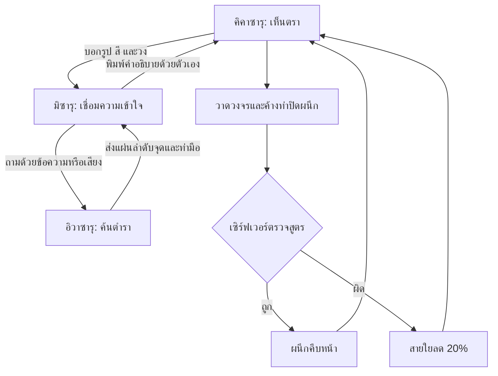

> ARCHIVE — เอกสารของเกมคาถารุ่น 2.x เก็บเพื่ออ้างอิงโค้ดเดิม กติกาหน้าเว็บปัจจุบันเปลี่ยนเป็น ASL แล้ว โปรดเริ่มที่ README.md และ ASL-SETUP-TH.md

# ส่วนขยาย Learning edition 2.1

เพิ่มเส้นทาง รู้จักแนวคิด → ทดลองคิด → เกม 3 คน → ถอดบทเรียน
ด้วยธีมหมึก เขียวป่า หยก ทองเก่า และพื้นกระดาษ ใช้ภาพ SVG เดิมในองค์ประกอบใหม่
รายละเอียดการออกแบบ ข้อมูล และข้อจำกัดอยู่ใน LEARNING-EDITION.md

คงกติกาข้อมูลที่แต่ละบทบาทเห็นไว้ ไม่เพิ่มความสามารถให้ตัวละครเห็นตำราหรือบอสเกินสิทธิ์
ส่วนเรียนรู้ทำงานใน browser และไม่ต้องเปลี่ยนฐานข้อมูลห้องออนไลน์

---

# SANZARU — พันธสัญญาสามวานร

เวอร์ชัน 2.0.0 · เปลี่ยนโหมดหลัก `/` ของ Portal Panic ให้มีธีม Three Wise Monkeys
ยังเล่นออนไลน์ 3 คนบนเซิร์ฟเวอร์เดียวกัน ใช้กล้องหน้าคอมพิวเตอร์หรือเมาส์ทดลองกติกา

## แก่นของเกม

> ไม่มีใครถือความจริงทั้งหมด แต่ทุกคนรับผิดชอบต่อสิ่งที่ตนส่งต่อ

แรงบันดาลใจคือ Three Wise Monkeys: see no evil, hear no evil, speak no evil
ภาพสลักลิงสามตัวที่ศาลเจ้า Nikkō Tōshō-gū เป็นตัวอย่างที่มีชื่อเสียง
อ้างอิงบริบทภาพสัญลักษณ์: [Japan National Tourism Organization](https://www.japan.travel/en/spot/1482/)

เกมนี้เป็นการตีความใหม่เพื่อการเล่นร่วมกัน ไม่ได้อ้างว่าพล็อตและความหมายทั้งหมด
เป็นคำสอนดั้งเดิม และไม่ใช่การจำลองความพิการทางการมองเห็น การได้ยิน หรือการพูด
คำว่า “ไม่มองความชั่ว” ในเกมจึงหมายถึงไม่เห็นอสูร/โจทย์โดยตรง มิซารุยังอ่าน UI และสารของเพื่อนได้

คำถามหลักไม่ใช่เพียง “ใครจำสูตรได้” แต่รวมถึง “เรารู้อะไรจริง”
“เรากำลังเดาแทนการถามหรือไม่” และ “สารที่เราเล่าต่อยังตรงกับสิ่งที่ได้รับมาหรือเปล่า”
ความสำเร็จมาจากทั้งสามหน้าที่ ไม่มีใครสามารถเล่นโดยอาศัยข้อมูลของตนลำพัง

## โลกและตัวละคร

ศาลกลางป่าตั้งอยู่ระหว่างความจริงกับภาพลวง “เงาอคติ” เติบโตจากความมั่นใจที่ไม่ตรวจสอบ
หน้ากากของมันแบ่งเป็นด้านสว่างและด้านมืด เพื่อสื่อว่าภาพเดียวกันอาจถูกเข้าใจต่างกัน
วานรสามตนรักษาพันธสัญญาคนละข้อ และต้องเชื่อมสิ่งที่แต่ละตนรู้เพื่อคลายผนึกทั้งห้า

### มิซารุ — Mizaru — 見猿 — See no evil

- รหัสภายใน `relay`; สีหยก; ภาพปิดตา
- ไม่มีภาพอสูร เป้าหมาย สูตร หรือวงจรเฉลยในข้อมูลที่เซิร์ฟเวอร์ส่งให้
- มีช่องถึงคิคาซารุและอิวาซารุ แยกประวัติข้อความกัน
- รับข้อความ/เสียงจากคิคาซารุ และรับสัญลักษณ์จากอิวาซารุ
- ส่งข้อความถึงคิคาซารุ; ส่งข้อความหรือคลิปเสียงถึงอิวาซารุ
- ไม่มีปุ่มส่งต่อแผ่นคำตอบถึงคิคาซารุ ต้องตีความแล้วเรียบเรียงเอง
- คำถามประจำตัว: เมื่อมองไม่เห็นทั้งหมด เราต้องกล้าถามก่อนตัดสิน

### คิคาซารุ — Kikazaru — 聞か猿 — Hear no evil

- รหัสภายใน `caster`; สีทองเก่า; ภาพปิดหู
- เห็นตราอสูรและกระดานวงจร แต่ไม่มีตำรา
- รับคำตอบเป็นตัวอักษร ไม่มีตัวเล่นเสียง และดาวน์โหลดคลิปผ่าน API ไม่ได้
- ส่งข้อความหรืออัดเสียงถึงมิซารุได้ แต่ไม่มีการฟังคลิปตัวเองย้อนหลัง
- ใช้นิ้วชี้ลากเส้นผ่านจุด 1–9 และทำท่าปิดผนึกค้าง 850 ms
- คำถามประจำตัว: ความเงียบเปิดที่ให้เราไตร่ตรอง ก่อนลงมือ

### อิวาซารุ — Iwazaru — 言わ猿 — Speak no evil

- รหัสภายใน `scribe`; สีม่วงหมอก; ภาพปิดปาก
- เห็นตำราหกสูตร แต่ไม่เห็นตราโจทย์หรืออสูร
- รับคำใบ้เป็นข้อความหรือคลิปเสียงจากมิซารุ
- ไม่มีช่องพิมพ์หรือปุ่มอัดเสียง เซิร์ฟเวอร์ปฏิเสธ free-text และ voice upload
- ตอบด้วยกระดานวาจาเงียบ: กดจุด 1–9 เรียงตามตำรา แล้วเลือกท่ามือ
- ลบจุดล่าสุดหรือล้างแผ่นได้ ส่งได้เมื่อมีอย่างน้อยสองจุดและเลือกท่าแล้ว
- มีสัญลักษณ์ ✓ เข้าใจแล้ว / ↻ ขอคำใบ้อีกครั้ง / … กำลังค้นตำรา
- คำถามประจำตัว: ถ้อยคำอาจหายไป แต่ความรับผิดชอบต่อสารยังอยู่

คำบรรยายสัญลักษณ์และชื่อท่ามีไว้ช่วยอ่าน UI และการเข้าถึง
ผู้เล่นอิวาซารุไม่สามารถใส่ถ้อยคำอิสระลงในสารที่ส่งได้

## วงจรการสื่อสาร



## ผนึกทั้งห้า

| ผนึก | คำถามที่แสดงระหว่างเล่น |
|---|---|
| ภาพลวง | สิ่งที่เห็น คือทั้งหมดของความจริงหรือ? |
| เสียงลือ | เราเชื่อเพราะรู้ หรือเพราะมีคนบอก? |
| ถ้อยคำ | คำอธิบายของเราเปลี่ยนความหมายไปหรือไม่? |
| ความไว้ใจ | เมื่อรู้อยู่เพียงบางส่วน เรายังไว้ใจใครได้? |
| ความรับผิดชอบ | เราเลือกทำอะไร กับความจริงที่ได้รับมา? |

นี่เป็นชั้นเนื้อเรื่องของผนึกทั้งห้า ไม่ใช่ระบบบอสห้าชนิดที่มีกฎใหม่คนละชุด
กติกาวงจร ท่ามือ เวลา และความเสียหายยังเป็นชุดเดียวกันทุกผนึก
สูตรสุ่มใหม่เมื่อเริ่มรอบ ชื่อผนึกไม่เปิดเผยสูตรหรือคำตอบ

ผลจบรอบชวนคุยว่า “ช่วงไหนที่เราเดาแทนที่จะถาม?” แล้วเปลี่ยนบทบาทกันใน Lobby
การเปลี่ยนมุมมองให้แต่ละคนได้สัมผัสข้อจำกัดของอีกสองฝ่าย

## กลไกที่คงไว้

- เล่น 3 คน/3 บทบาท; ทุกคนกดพร้อม เจ้าของห้องเริ่ม นับถอยหลัง 3 วินาที
- ปิด 5 ผนึกภายใน 240 วินาที; เริ่มสายใย 100; ผิดครั้งละ 20
- ร่ายถูกเพิ่ม 1000 คะแนน; ชนะมีโบนัสเวลาและสายใยที่เหลือ
- คูลดาวน์ 2 วินาทีหลังการร่ายที่ถูกตัดสิน
- MediaPipe ตรวจ landmark/gesture ฝั่งเครื่องผู้เล่น; ภาพกล้องไม่ส่งเข้า API เกม
- เส้นวงจรตรวจด้วยกฎเรขาคณิต และท่ามือต้องตรงสูตร
- โหมดเมาส์/คีย์บอร์ดทดลองกติกาได้ แต่ไม่ใช่การทดสอบความแม่นยำ AI
- HTTP polling, คิวคำสั่ง, token, revision, acknowledge และป้องกันคำสั่งซ้ำ
- พักเกม, reconnect, เล่นใหม่, เปลี่ยนบทบาท, ข้อความเสียง และห้องหมดอายุ

## จุดที่แก้ในซอร์ส

| ไฟล์ | การเปลี่ยน |
|---|---|
| `app/page.tsx` | ชื่อเกม ตัวละคร Lobby HUD ตำรา บอส ผนึก คำแนะนำ ผลจบ และ dialog แนวคิด |
| `app/ritual/monkey.tsx` | แสดงภาพลิงตามบทบาทและเรื่องราว |
| `app/ritual/signals.tsx` | UI เรียงสัญลักษณ์, ลบ/ล้าง, เลือกท่า, ส่ง, และแสดงผล |
| `app/ritual/chat.tsx` | เลือกตัวควบคุมตามพันธสัญญา จำกัดการฟัง/พูดและแสดงแผ่นสาร |
| `app/ritual/circuit.tsx` | เปลี่ยนข้อความและบริบทการวาดวงจร |
| `app/sanzaru.css` | ชุดสีหมึก/หยก/ทองเก่า layout ตัวละครและสารเงียบ responsive/reduced motion |
| `app/layout.tsx` | Metadata ชื่อเกมใหม่และโหลด CSS |
| `lib/ritual-shared.ts` | Role metadata, chapters, silent intents, signal type/validator, voice policy |
| `lib/ritual-engine.ts` | Action `signal`, ข้อจำกัด free-text/voice, การกรองข้อความตามบทบาท |
| `lib/ritual-store.ts` | ตรวจสิทธิ์เสียงก่อนเก็บ/ส่งกลับ รวมการปฏิเสธคิคาซารุฟังเสียงตนเอง |
| `lib/ritual-batch.ts` | จบ batch หลัง `chat` หรือ `signal` เพื่อไม่ชน rate limit ใน transaction |
| `public/assets/sanzaru/` | ภาพ vector ต้นฉบับของสามวานร ศาล และหน้ากากเงาอคติ |
| `tests/ritual.test.mjs` | ตรวจพันธสัญญา สัญลักษณ์ payload และเสียงผ่าน API |
| `tests/local-smoke.mjs` | เพิ่ม assets/กติกาใหม่สำหรับตรวจบนเซิร์ฟเวอร์ local ที่เปิดอยู่ |

## โครงสร้างข้อความเงียบ

```ts
// คำตอบที่ผู้เล่นประกอบเองจากตำรา
{ type: "signal", seq: 7, to: "relay",
  signal: { kind: "route", nodes: [1, 2, 5, 8, 9], gesture: "Victory" } }

// สถานะสั้นที่เลือกจากรายการตายตัว
{ type: "signal", seq: 8, to: "relay",
  signal: { kind: "intent", intent: "repeat" } }
```

เซิร์ฟเวอร์รับจุดจำนวน 2–9 จุด แต่ละจุดเป็นจำนวนเต็ม 1–9
ท่ามือเป็นหนึ่งใน 4 ท่าที่กำหนด และตัดฟิลด์อื่นทิ้งก่อนเก็บข้อความ
โครงสร้างฐานข้อมูลเดิมเก็บสถานะห้องเป็น JSON จึงไม่ต้องมี SQL migration ใหม่
รหัสบทบาทภายในเดิมช่วยให้อ่านเทียบกับรุ่นก่อนง่าย
ควรเริ่มห้องใหม่เมื่อเปลี่ยนจากรุ่นเก่ามาใช้เวอร์ชันนี้ เพื่อไม่มีประวัติสารตามกติกาเก่าปะปน

## ขอบเขตการส่งมอบ

หน้า `/` เป็น SANZARU ส่วน `/classic` ยังเป็นโหมด Portal Panic รุ่นก่อนสำหรับ 1–2 คน
เก็บซอร์สเดิมไว้ครบ แต่เอาลิงก์ลัดโหมดเก่าออกจากแถบหัวของเกมหลัก
ภาพ SVG เป็นภาพต้นฉบับที่สร้างด้วยโค้ดในชุดนี้ ไม่มีภาพสลักโบราณที่ดาวน์โหลดมาประกอบ
ผู้เล่นควรสื่อสารผ่านในเกม เพราะโปรแกรมไม่สามารถห้ามการคุยหรือดูจอกันนอกเกมได้

ตรวจ TypeScript, automated tests และ production build แล้ว
ยังไม่ได้ตรวจหน้าจอด้วย browser automation หรือทดสอบกล้อง/ไมค์จริงในรอบนี้
โค้ดยังไม่ใช่ผลรับรองความแม่นยำ 8/10 และไม่มีโมเดล Roboflow ที่ฝึกเพิ่ม
ไม่มีการเผยแพร่เว็บไซต์หรือสร้าง Worker ออนไลน์ในการส่งมอบครั้งนี้
