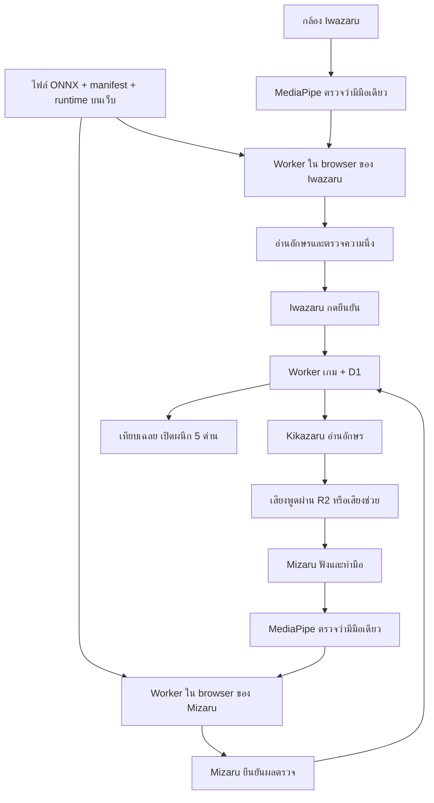

# SANZARU — การทำงานของ ONNX Runtime Web

รุ่นนี้ให้ Iwazaru และ Mizaru ดาวน์โหลดโมเดล ASL แล้วตรวจภาพบนเครื่องตนเองผ่าน ONNX Runtime Web ผู้เล่นใช้เว็บและอนุญาตกล้องได้เลย Python ใช้เฉพาะตอนแปลงโมเดล ไม่ต้องเปิด Python API ค้างไว้ขณะเล่น

คู่มือลงมือเตรียมโมเดลอยู่ใน [ASL-SETUP-TH.md](ASL-SETUP-TH.md) เอกสารนี้อธิบายการออกแบบ ขอบเขต และโค้ดที่เปลี่ยน

## 1. ลำดับการทำงาน

ภาพกล้องและ landmarks อยู่ใน browser ของผู้เล่น ระบบห้องได้รับอักษร confidence ระยะเวลาถือท่า อายุผล และ model fingerprint ส่วนเสียงยังส่งผ่านระบบเดิมเมื่อคนกลางกดส่ง

## 2. การโหลดโมเดล

1. อ่าน manifest จาก `/models/asl/manifest.json` หรือ URL ที่ตั้งในหน้ากล้อง
2. ตรวจ schema, class mapping, threshold, ชื่อ input/output และ output layout
3. ดาวน์โหลด ONNX และตรวจ SHA-256 ของไฟล์เทียบ manifest
4. โหลด runtime จากเว็บเดียวกัน ตรวจเวอร์ชัน JavaScript และ hash ของ WASM
5. โหมดอัตโนมัติลองสร้าง session และ warm-up ด้วย WebGPU ถ้าไม่พร้อม/รันไม่ได้จะสร้าง session WASM
6. ตรวจ input จริงว่าตรง `[1,3,S,S]` แบบ float32 และตรวจ output จากการรันจริง
7. เปิดกล้องและ MediaPipe แล้วประกาศความสามารถของโมเดลให้ระบบห้อง

ปุ่มยกเลิก/ปิดกล้องจะ terminate Worker หยุดดาวน์โหลดหรือ inference ที่ค้าง และปิด video tracks การกลับออกจากหน้าหรือเปลี่ยนบทบาทใช้การเก็บกวาดเดียวกัน

WebGPU ใช้ GPU เมื่ออุปกรณ์และ browser รองรับ ส่วน WASM ใช้ CPU ผู้เล่นสามารถเลือก WASM เองได้ หาก GPU มีปัญหาระหว่างเล่นระบบหยุดรับผลและให้เปิดใหม่หรือเลือก WASM ไม่ใช้ผลเก่าตอบแทน

## 3. การเตรียมภาพ

ขอภาพกล้อง 1280×720 (เบราว์เซอร์อาจเลือกขนาดอื่น) ส่งภาพต้นฉบับเป็น `ImageBitmap` เข้า dedicated Web Worker แล้ว:

- ค่าเริ่มต้น `inputMode: hand-crop` ขยายบริเวณมือที่ MediaPipe พบ พร้อมบริบทรอบนิ้ว/ข้อมือ ก่อน resize
- `mirror: true` กลับซ้ายขวาก่อนทำนายเหมือน webcam_detect.py และแปลงตำแหน่งมือให้ตรงกัน

- ปรับขนาดแบบ letterbox รักษาสัดส่วนภาพ และเติมขอบด้วย RGB `(114,114,114)`
- ใช้ภาพ RGB และหารค่าช่องสีด้วย 255
- จัดข้อมูลเป็น float32 NCHW `[1,3,S,S]`
- ใช้ขนาด `S` ตาม manifest ซึ่งต้องตรงกับ input จริงของ ONNX

ภาพ preview กลับด้านด้วย CSS ส่วน Worker กลับภาพตาม `mirror` ใน manifest รองรับ `full-frame` และ `hand-crop` สำหรับ YOLO detect ทั้งสองแบบใช้ RGB/255/NCHW และ letterbox การเปลี่ยน mode/mirror เปลี่ยน fingerprint เพื่อให้สองผู้เล่นใช้ค่าชุดเดียวกัน รุ่นเร็วใช้ input 384 และมีรุ่น 640 ให้เลือกในตั้งค่าโมเดล

MediaPipe ใช้ระบุตำแหน่งมือและตรวจจำนวนมือ ชื่อท่าของ MediaPipe ไม่ถูกนำมาแปลงเป็นคำตอบ ASL

## 4. รูปแบบ output ที่รองรับ

| `outputFormat` | รูปร่าง | ความหมาย | การประมวลผล |
|---|---|---|---|
| `end2end` | `[1,N,6]` | `x1,y1,x2,y2,confidence,class_id` | กรองคะแนน ไม่ทำ NMS ซ้ำ |
| `raw-bcn` | `[1,4+C,N]` | `cx,cy,w,h` และคะแนน C class | เลือก class สูงสุด แล้ว class-aware NMS |
| `raw-bnc` | `[1,N,4+C]` | แบบเดียวกัน แต่สลับแกน | เช่นเดียวกับ raw-bcn |

พิกัดกล่องต้องเป็นพิกเซลในภาพ input ที่ letterbox แล้ว คะแนนต้องเป็น probability 0–1 ไม่มี objectness เพิ่ม ไม่มี sigmoid ใน adapter ไม่มี mask/pose/OBB และไม่มี output แบบ normalized coordinates หรือ logits

สคริปต์ export ตรวจ shape หลัง export จริง ไม่สมมติว่า YOLO ทุกเวอร์ชันให้ผลเหมือนกัน รูปแบบสำเร็จรูป `[1,N,6]` อาจมาจาก head แบบ NMS-free หรือ graph ที่ฝัง NMS แล้ว ชื่อ `end2end` ใน manifest หมายถึงรูปแบบแถว ไม่ได้ยืนยันวิธีฝึก

ตัวอ่านผลแปลงกล่องกลับจาก letterbox ไปเป็นพิกัดภาพต้นฉบับ จากนั้นเลือก detection ที่สัมพันธ์กับมือเดียวที่ MediaPipe พบ โดยใช้ intersection หารพื้นที่กล่องที่เล็กกว่า ค่าเริ่มต้นอย่างน้อย 0.2 แล้วเลือกคะแนนสูงสุด หาก class ที่ชนะถูก map เป็น `null` จะไม่ส่งอักษร

## 5. Class mapping และ A–Z

ลำดับ `labels` ตรงกับ class ID จริง เช่น `labels[0]` อาจเป็น Z ไม่จำเป็นต้องเป็น A สคริปต์ใช้ `model.names` และเปิดให้กำหนด mapping ชื่อ class แบบ exact match ได้

เกมและหน้าเรียนรู้เลือก A–Z ได้ แต่จะเริ่มเกม AI ได้ต่อเมื่อโมเดลของทั้งสองคนรองรับอักษรทุกตัวที่ห้องเลือก ค่าเริ่มต้นห้องยังเป็น A/B/C/L/Y และสุ่ม 5 ตัวไม่ซ้ำ

**J/Z ในรุ่นนี้เป็น class จากภาพตาม dataset เท่านั้น** ยังไม่มี temporal model หรือการตรวจเส้นทางนิ้ว จึงไม่ควรอ้างว่าตรวจการทำ J/Z ตาม ASL ได้ครบ ให้เลือกไม่ใช้สองตัวนี้เมื่อต้องการกิจกรรมอักษรท่านิ่ง

## 6. ความนิ่งและการปฏิเสธผลเก่า

- confidence ค่าเริ่มต้น 0.50 เหมือน Python และตั้งต่ำกว่า 0.50 ไม่ได้ ทั้ง manifest และเซิร์ฟเวอร์เกม
- ต้องพบอักษรเดิมอย่างน้อย 3 observations และกินระยะ capture time อย่างน้อย 900 ms
- ผลที่เก่ากว่า 1,500 ms ไม่นับเป็นหลักฐาน ทั้งตอนรับผลและตอนกดยืนยัน
- ส่ง inference ทีละเฟรม เว้นอย่างน้อย 200 ms ไม่สะสมคิวภาพ
- ถ้าไม่พบมือ พบมากกว่าหนึ่งมือ มือกระโดดตำแหน่ง เปลี่ยนแท็บ เปลี่ยนด่าน หรือยืนยันคำตอบ จะ reset streak
- generation และ observation epoch ป้องกันผล async ของกล้อง/ด่านก่อนหน้ากลับมาใช้ภายหลัง

ค่า latency รวมการหามือ การส่งเฟรมเข้า Worker การเตรียมภาพ และ inference มีตัวเลขแยกแต่ละขั้นตอน ค่า default เป็นรุ่น 384 สำหรับลดภาระ WASM ขณะมี inference ค้างจะตรวจมือทุก 250 ms เพื่อไม่ให้ MediaPipe แย่ง CPU มากเกินไป ผลที่เก่ากว่า 1.5 วินาทียังถูกปฏิเสธ

## 7. ตรวจโมเดลตรงกันทั้งสองคน

`modelId` เป็น SHA-256 ของข้อมูลที่เรียงลำดับแน่นอน ได้แก่ hash ของ ONNX, mapping, input/output, thresholds, รุ่น adapter และรุ่น ONNX Runtime Web ส่วน URL และ execution provider ไม่อยู่ใน identity จึงใช้โมเดลเดียวกันจากคนละ URL หรือคนละ backend ได้

ระบบห้องยังเปรียบเทียบ modelId ก่อนเริ่ม และตอนส่งคำตอบต้องตรงกับตอนกดพร้อม หากเปลี่ยนโมเดลระหว่างเล่นให้กลับล็อบบีและเริ่มใหม่ ชุดค่าที่ตรงกันไม่ได้รับรองว่าตัวเลขทำนาย GPU/CPU จะเหมือนกันทุกกรณี จึงต้องเปรียบเทียบกับภาพจริง

ผลที่ client รายงานไม่ใช่หลักฐานเข้ารหัสเพื่อป้องกันโกง ผู้เล่นดาวน์โหลดโมเดลได้ เพราะโมเดลต้องอยู่บนเครื่องผู้เล่นเพื่อคำนวณ

## 8. ไฟล์ที่เกี่ยวข้อง

| ไฟล์ | หน้าที่ |
|---|---|
| `app/asl/use-asl-camera.ts` | กล้อง MediaPipe lifecycle ความนิ่ง และการยืนยันผล |
| `app/asl/camera-panel.tsx` | สถานะโหลด backend การตั้ง manifest และตัวเลือก WASM |
| `lib/asl-browser-model.ts` | สื่อสารกับ Worker, timeout, cancel |
| `lib/asl-onnx.worker.ts` | โหลด/ตรวจ hash, สร้าง session, warm-up, preprocessing และ inference |
| `lib/asl-onnx.ts` | schema, RGB/NCHW, letterbox, decoder, NMS, hand association, fingerprint |
| `lib/asl-inference.ts` | stabilizer และ proof อายุผล; parser Python เดิมเก็บไว้สำหรับ compatibility |
| `lib/asl-shared.ts` | alphabet A–Z และชุดอักษรเกม |
| `lib/asl-engine.ts` | ยืนยันความสามารถของโมเดลและตรวจคำตอบ |
| `scripts/export-asl-onnx.py` | แปลง .pt หรือสร้าง manifest จาก ONNX ที่มี metadata |
| `scripts/prepare-onnx.mjs` | เตรียม runtime จาก dependency รุ่นเดียวกันสำหรับ deploy |
| `public/models/asl/` | ONNX และ manifest ที่สร้างจากโมเดลของทีม |
| `public/onnx/` | runtime ที่สร้างอัตโนมัติ ไม่ต้องแก้เอง |
| `tests/asl-onnx.test.mjs` | ตรวจ geometry, tensor, mapping, output และ fingerprint |
| `tests/asl-browser-smoke.mjs` | ทดสอบ runtime จริงใน browser ด้วยโมเดลสังเคราะห์ |
| `tests/test_export_asl_onnx.py` | ตรวจ class mapping และ shape ของ exporter |

Python API และเกม classic ยังอยู่เป็นโค้ดเดิม แต่หน้า `/play` และ `/lab` ใช้ browser inference แล้ว เอกสาร API รุ่นก่อนเก็บที่ `docs/archive/ASL-PYTHON-SETUP-TH.md`

## 9. Runtime และการ deploy

ติดตั้ง `onnxruntime-web` แบบระบุเวอร์ชันแน่นอนและใช้ lockfile `pnpm dev` และ `pnpm build` เรียก prepare script อัตโนมัติ หรือเรียก `pnpm prepare:onnx` เองได้

Runtime 1.30.0 มี JSEP WASM ขนาดเกิน 25 MiB สคริปต์จะแบ่งเป็นไฟล์ `.bin` ชิ้นละไม่เกิน 20 MiB พร้อม hash browser รวมกลับเป็น bytes เดิมแล้วส่งให้ `ort.env.wasm.wasmBinary` และโหลด module `.mjs` ที่ตรงรุ่นจาก origin เดียวกัน ไม่เปลี่ยนเนื้อหา WASM

ใช้หนึ่ง WASM thread ภายใน dedicated Worker จึงไม่ต้องเพิ่ม COOP/COEP เพื่อใช้ SharedArrayBuffer runtime ไม่ได้โหลดจาก CDN โมเดลใช้ HTTP cache ตามเซิร์ฟเวอร์ โดย revalidate ONNX/manifest เมื่อเปิดใหม่ รุ่นนี้ไม่มี Service Worker หรือ IndexedDB offline cache ของตัวเอง

ถ้าตั้ง CSP เอง ให้รองรับ Worker ของเว็บ, module scripts, WASM compilation (`wasm-unsafe-eval`) และ `connect-src` สำหรับ URL โมเดลด้วย ไม่ควรลบ CSP ทั้งหมดเพื่อแก้ปัญหา

## 10. ผลตรวจด้วยโมเดลจริงและขอบเขตที่เหลือ

แปลง YOLO26n ของทีมแล้ว ผล checkpoint/ONNX ตรงกัน 54/54 ภาพ และ production Worker ให้ผลตรงกับ ONNX CPU 54/54 ภาพทั้ง WASM และ auto fallback รุ่นใหม่ input 384 + WASM 4 เธรดมี p50 ประมาณ 44 ms ต่อภาพบนเครื่องทดสอบ (ไม่รวมกล้อง/MediaPipe) ดู [MODEL-REPORT-TH.md](MODEL-REPORT-TH.md) สำหรับวิธีเลือกภาพ ค่า threshold และข้อจำกัดของผลนี้

ยังต้องทดสอบกล้องจริง แสงหลายแบบ มือซ้าย/ขวา อักษรที่สับสนกัน และ WebGPU บนอุปกรณ์ที่รองรับ บันทึกผลใน `/lab` แล้วทดลองเกมสามเครื่องครบห้าด่าน ยังไม่มีผลด้านการเข้าถึงกับผู้ใช้จริง

## แหล่งอ้างอิง

- [ONNX Runtime Web: การใช้ WebGPU](https://onnxruntime.ai/docs/tutorials/web/ep-webgpu.html)
- [ONNX Runtime Web: ไฟล์ที่ต้อง deploy และ WASM](https://onnxruntime.ai/docs/tutorials/web/deploy.html)
- [Ultralytics: output แบบ raw และ end-to-end](https://docs.ultralytics.com/guides/end2end-detection/)
- [Ultralytics: export ONNX](https://docs.ultralytics.com/integrations/onnx/)

## WASM หลายเธรด

ตั้ง `numThreads` ไม่เกิน 4 และไม่เกินครึ่ง logical CPU เมื่อ `crossOriginIsolated` เป็นจริง มิฉะนั้นใช้ 1 เธรด ใส่ COOP same-origin และ COEP require-corp ทั้ง SSR ใน `build/sites-worker.ts`, static assets ใน `public/_headers` และ Vite dev headers การเพิ่มเธรดไม่รับประกันความเร็ว จึงวัดรุ่น 384/640 แยกกัน ดู [PERFORMANCE-ASL-TH.md](PERFORMANCE-ASL-TH.md)
