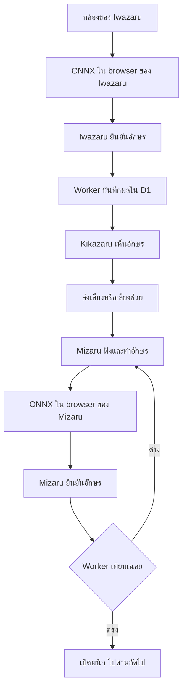

# SANZARU 3.0 — Hand to Heart

เกมเว็บร่วมมือ 3 คนตามแนวคิด Three Wise Monkeys ใช้ **การตรวจอักษร ASL จากภาพด้วย ONNX Runtime Web** เพื่อส่งต่อความหมายและปลดผนึก 5 ด่าน

เวอร์ชันนี้เปลี่ยนหน้าเว็บหลักจากการร่ายคาถาเป็นการเรียนรู้อักษร ASL และการสื่อสารที่เปิดให้ผู้เล่นเลือกตัวช่วยได้ ตัวละครและธีมสามวานรยังอยู่ครบ

**สถานะ:** แปลง checkpoint `best.pt` ของทีมเป็น ONNX และรวมในเว็บแล้ว รองรับ A–Z และไม่ส่งคำตอบเมื่อเป็น `nothing` ผ่านการเทียบกับ checkpoint, browser WASM, ระบบห้อง D1/R2 ในเครื่อง และ build สำหรับ Cloudflare ชุดอัปเดตนี้ยังไม่ได้ deploy จากรอบงานนี้ และยังไม่ได้ทดสอบกล้อง/ไมค์กับผู้เล่นจริง

รวม ONNX รุ่นเร็ว 384 และรุ่นละเอียด 640 แล้ว ใช้ภาพขยายบริเวณมือ, mirror, confidence 0.50 และ WASM หลายเธรดเมื่อรองรับ

## เริ่มเปิดเว็บบนเครื่องของคุณ

ติดตั้ง Node.js 22.13 ขึ้นไป (ใช้ Node 24 ตรวจรุ่นนี้) และเปิด terminal ในโฟลเดอร์ `Sanzaru` ที่ clone จาก GitHub แล้ว

```sh
git clone https://github.com/Kasuiii/Sanzaru.git
cd Sanzaru
npm install --global pnpm@11.25.0
pnpm install --frozen-lockfile
pnpm setup:local
pnpm start
```

เปิด **http://localhost:8787** และปล่อย terminal ทำงานอยู่

- `pnpm setup:local` ทำ build และสร้าง/อัปเดตตาราง D1 จำลองในเครื่อง รวม migration `0002_asl_hand_to_heart.sql`
- `pnpm start` เปิด Worker จำลองพร้อมฐานข้อมูลและที่เก็บเสียงในเครื่อง ไม่ส่งขึ้นบัญชี Cloudflare
- ครั้งถัดไปที่ไม่ได้แก้โค้ด ใช้ `pnpm start` ได้เลย หากแก้โค้ดให้ build ใหม่ก่อน
- เปิด `/play` เลือก **ทดลองกติกาด้วยแป้นพิมพ์** เพื่อเล่นระบบทั้งหมดโดยไม่มี AI จากนั้นใช้ 3 เบราว์เซอร์หรือ 3 โปรไฟล์แยกกันทดสอบ 3 บทบาท
- `localhost` เป็นเครื่องของผู้เปิด ไม่ใช่ลิงก์ให้เพื่อนต่างเครื่อง ต้องให้เพื่อนเข้าเว็บบนเซิร์ฟเวอร์เดียวกันผ่าน HTTPS
- ปุ่ม `install:ci` เป็นเครื่องมือสำหรับสภาพแวดล้อมพัฒนา Linux ไม่จำเป็นสำหรับ Windows ของคุณ

## ใช้โมเดล ASL จริง

โมเดลทั้งสองขนาดมาจาก checkpoint เดียวกัน เป็น YOLO26n FP32, ONNX opset 17, input `[1,3,S,S]` และ output `[1,300,6]` แบบ end-to-end:

1. โปรเจกต์นี้มีโมเดลจริงและ `public/models/asl/manifest.json` พร้อมใช้งานแล้ว ไม่ต้อง export ซ้ำ
2. เลือก **384 · เร็ว** เป็นค่าเริ่มต้น หรือ **640 · รายละเอียดสูง** ในตั้งค่าโมเดลของทีม ทั้งสองผู้เล่น AI ต้องใช้โปรไฟล์เดียวกัน
3. ไฟล์ ONNX มีชื่อพร้อม hash และ manifest สร้างจากชื่อ class/output จริง
4. รัน `pnpm setup:local` และ `pnpm start` แล้วให้ Iwazaru/Mizaru กดเชื่อมโมเดลและเปิดกล้อง
5. Browser ลอง WebGPU และใช้ WASM สำรอง ตรวจ fingerprint ทั้งคู่ก่อนเริ่ม ไม่ต้องเปิด Python API ระหว่างเล่น

หากเปลี่ยน checkpoint ใช้ `python scripts/export-asl-onnx.py --help` เพื่อดูพารามิเตอร์ export และ `models/asl-class-map.json` สำหรับชุด 27 class นี้ ต้องมี Python/Ultralytics เฉพาะขั้นตอน export และทดสอบโมเดลใหม่

**MediaPipe ที่รวมมาใช้หาตำแหน่งมือเท่านั้น ไม่ใช่โมเดล ASL** ระบบไม่แปลงชื่อท่าเดิมอย่าง Victory หรือ Closed_Fist เป็นคำตอบ ASL โดยอัตโนมัติ และไม่สร้างผลทำนายจำลองในโหมด AI

## กติกา

| บทบาท | ข้อมูลที่ได้รับ | หน้าที่ |
|---|---|---|
| Iwazaru · 言わ猿 | เฉลยอักษรของด่านปัจจุบัน | รอคำขอจาก Kikazaru ทำอักษรด้วยมือ ยืนยันอักษรที่โมเดลตรวจได้ |
| Kikazaru · 聞か猿 | อักษรที่ตรวจได้จาก Iwazaru | ขอคำตอบ อ่านอักษร อัดเสียงแล้วส่งให้ Mizaru หรือใช้เสียงช่วย |
| Mizaru · 見猿 | สารเสียงจาก Kikazaru | ฟัง ทำอักษรด้วยมือ แล้วส่งผลจากโมเดลชุดเดียวกันเพื่อตรวจเทียบเฉลย |

เจ้าของห้องเลือกชุดอักษรได้ตั้งแต่ 5–26 ตัว ระบบสุ่ม 5 ตัวไม่ซ้ำเป็น 5 ด่าน ค่าเริ่มต้น A, B, C, L, Y

- ทั้งสามคนกดพร้อม จากนั้นเจ้าของห้องเริ่มเกม
- ลำดับแต่ละด่าน: Kikazaru ขออักษร → Iwazaru ส่งผลตรวจ → Kikazaru ส่งเสียง → Mizaru ส่งผลตรวจ
- อักษรที่ส่งเป็น **ผลที่ตรวจได้** ไม่ได้บังคับให้กลายเป็นเฉลย ถ้าผิดสามารถขอทวน ส่งใหม่ และลองใหม่ได้
- จบเมื่อ Mizaru ตอบตรงกับเฉลยครบ 5 ด่าน ไม่มีเวลานับถอยหลัง ไม่มีแพ้เพราะลองผิด
- ทุกคนขอพักได้ เจ้าของห้องกลับล็อบบีและหมุนเวียนบทบาทได้ระหว่างรอบ
- เสียงเป็นคลิปครั้งละไม่เกิน 8 วินาที ไม่ใช่สายสนทนาสด
- Mizaru กดฟังซ้ำได้ หรือเลือกเปิดอักษรประกอบเสียงจากเมนูการเข้าถึง อักษรนี้มาจากอักษรที่คนกลางส่ง ไม่ใช่ระบบถอดเสียงพูด

## หน้าเว็บที่มี

| URL | สิ่งที่ทำได้ |
|---|---|
| `/` | หน้าหลักธีม Hand to Heart แนะนำตัวละคร วิธีเล่น ห้าผนึก และจุดมุ่งหมาย |
| `/play` | สร้าง/เข้าห้อง เลือกบทบาท ตั้งชุดอักษร ตรวจโมเดล เล่นร่วมกัน สรุปและดาวน์โหลดบันทึก |
| `/lab` | ฝึกอักษร ตรวจกล้อง บันทึกการทดลอง AI 10 ครั้ง และดาวน์โหลด CSV |
| `/chronicle` | ประวัติสามวานร การตีความสำหรับเกม การเข้าถึง และแหล่งอ้างอิง |
| `/workshop` | แผนกิจกรรมประมาณ 30 นาที ดาวน์โหลดแผน และแนวทาง pitch |
| `/classic` | เกมเดิมที่เก็บไว้สำหรับอ้างอิง ไม่ใช่เกม ASL |

การเข้าถึง: ปุ่มตัวอักษรใหญ่ ความต่างสีสูง ลดการเคลื่อนไหว อ่านสถานะด้วยเสียง อักษรประกอบเสียง focus สำหรับคีย์บอร์ด และข้อความสถานะสำหรับตัวอ่านหน้าจอ ไม่ได้อ้างว่าผ่านการรับรอง WCAG หรือรองรับความพิการทุกรูปแบบ

## โครงสร้างโค้ดปัจจุบัน

| ตำแหน่ง | ความรับผิดชอบ |
|---|---|
| `app/asl/home.tsx` | หน้าหลักและข้อมูลบทบาท |
| `app/asl/game.tsx` | ล็อบบี หน้าของแต่ละบทบาท หน้าสรุป และโหมดแป้นพิมพ์ |
| `app/asl/shell.tsx` | เมนู ตัวช่วยการเข้าถึง ตัวละคร และ SVG ตราผนึก |
| `app/asl/camera-panel.tsx` | UI กล้อง ผลตรวจ manifest และตัวเลือก WebGPU/WASM |
| `app/asl/use-asl-camera.ts` | เปิด/ปิดกล้อง หาตำแหน่งมือ ส่งเฟรมเข้า Worker และเก็บความนิ่ง |
| `app/asl/use-asl-room.ts` | session ของผู้เล่น polling คำสั่งห้อง และส่ง/รับเสียง |
| `app/asl/voice.tsx` | อัดคลิปเสียง เล่นเสียงจากคนกลาง และเสียงช่วย |
| `app/asl/learn.tsx` | แบบฝึกกับการทดลอง 10 ครั้ง |
| `app/asl/philosophy.tsx` | เนื้อหาแนวคิดและการเข้าถึง |
| `app/asl/workshop.tsx` | เนื้อหาสำหรับผู้จัดกิจกรรมและการ pitch |
| `app/asl.css` | ดีไซน์และ responsive ของรุ่น ASL แยกจาก CSS เกมเดิม |
| `lib/asl-shared.ts` | บทบาท อักษร ด่าน และแหล่งอ้างอิง |
| `lib/asl-browser-model.ts`, `lib/asl-onnx.worker.ts` | โหลดและรัน ONNX ใน dedicated Worker |
| `lib/asl-onnx.ts` | manifest, letterbox, RGB/NCHW, output decoder, NMS และ fingerprint |
| `scripts/export-asl-onnx.py`, `scripts/prepare-onnx.mjs` | เตรียมโมเดลและ runtime สำหรับเว็บ |
| `lib/asl-inference.ts` | ตรวจรูปแบบผลโมเดลและความนิ่งของอักษร |
| `lib/asl-engine.ts` | กฎเกม สิทธิ์บทบาท เปรียบเทียบคำตอบ และข้อมูลที่แต่ละคนเห็น |
| `lib/asl-store.ts` | D1 state, revision/CAS, token hash, R2 voice |
| `lib/asl-http.ts` | จำกัดคำขอ ตรวจ origin และตอบข้อผิดพลาด |
| `app/api/asl/route.ts` | POST create/join/sync/action |
| `app/api/asl/voice/route.ts` | อัปโหลดและดาวน์โหลดเสียงตามสิทธิ์ |
| `db/schema.ts`, `drizzle/0002_asl_hand_to_heart.sql` | ตารางห้อง ASL และ migration |
| `ai-server/asl_app.py` | Python FastAPI รุ่นก่อน เก็บไว้สำหรับอ้างอิง |
| `ai-server/asl_core.py` | ตรวจ config, class mapping และจับคู่ detection กับมือ |
| `ai-server/predictor.py` | adapter ของ Ultralytics ที่ใช้ร่วมกับ API เดิม |
| `ai-server/asl-config.json` | path โมเดล mapping และ thresholds |
| `public/vision/` | MediaPipe/WASM ที่โหลดจากเว็บเอง |
| `tests/asl*.test.mjs`, `ai-server/test_asl_service.py` | ทดสอบกติกา API และเงื่อนไข inference |

`app/academy`, `lib/ritual-*`, `lib/party-*` และ `ai-server/app.py` เก็บไว้เพื่ออ้างอิงเกมเดิม หน้าเว็บหลักรุ่นนี้ใช้ `app/asl` และ ONNX Runtime Web

## ลำดับข้อมูล



Browser ของผู้เล่นประมวลผลภาพ ส่วน Cloudflare Worker เก็บกติกาเกม D1 เก็บห้องและผลคำสั่ง ส่วน R2 เก็บเฉพาะคลิปเสียง เว็บไม่ได้ส่งวิดีโอของผู้เล่นให้กัน

## ตรวจโปรเจกต์

```sh
pnpm typecheck
pnpm test
pnpm build
pnpm check:deploy
```

ทดสอบ exporter helpers โดยไม่โหลด weights:

```sh
python -m unittest discover -s tests -p test_export_asl_onnx.py
node tests/asl-browser-smoke.mjs --built
```

ผล benchmark ใน Chromium/Windows เครื่องทดสอบ ใช้ภาพที่เตรียมไว้และไม่เปิดกล้อง:

| รุ่น / Backend | เธรด | median | p95 |
|---|---:|---:|---:|
| 384 / WASM | 4 | 44 ms | 98 ms |
| 384 / Auto → WASM | 4 | 50 ms | 65 ms |
| 384 / WASM ไม่มี isolation | 1 | 105 ms | 171 ms |
| 640 / WASM | 4 | 282 ms | 360 ms |

เวลารวม Worker messaging, เตรียมภาพ และ ONNX แต่ไม่รวมกล้อง, MediaPipe หรือ decode ภาพ จึงไม่รับประกันเวลาเดียวกันบนทุกเครื่อง ดูข้อมูลดิบใน [รายงาน browser](docs/testing/asl-browser-validation.json)

เทียบ tensor เดียวกันระหว่าง `.pt` กับ ONNX ผ่าน 54/54 ภาพทั้งสองขนาด รุ่น 384 ตอบอักษรถูก 49/52 และงดตอบ 3; nothing งดตอบ 2/2 นี่เป็นตัวอย่างที่เลือกไว้ ไม่ใช่ accuracy ทั้ง dataset ดู [รายงานโมเดล](docs/testing/asl-model-validation.json)

ผ่าน typecheck, 11 test scripts, exporter tests และ production build รายงานการกดหน้า `/lab` กับ `/play` เป็นผลก่อน rebuild ครั้งสุดท้ายที่ลบ import ไม่ได้ใช้และเพิ่มคำอธิบาย lint ไม่ได้กดทดสอบหน้าเว็บซ้ำหลังจากนั้น และยังไม่ได้ยืนยัน WebGPU จริงหรือระยะตรวจมือจากกล้องจริง

## Deploy และข้อมูล

ใช้ Cloudflare Worker + D1 สำหรับห้องเกม และ R2 สำหรับคลิปเสียง ส่วน ONNX รันใน browser

1. รัน `pnpm exec wrangler login` แล้วใช้ D1/R2 ที่มีอยู่ หรือสร้างด้วย `pnpm exec wrangler d1 create sanzaru-db` และ `pnpm exec wrangler r2 bucket create sanzaru-voice`
2. คัดลอก `wrangler.production.example.jsonc` เป็น `wrangler.production.jsonc` ใส่ชื่อ Worker, D1 `database_name`/`database_id` และ R2 `bucket_name` จริง คงชื่อ binding `DB` และ `BUCKET`
3. Build แล้ว apply migrations และ deploy ด้วย config บัญชีของคุณ:

```sh
pnpm build
pnpm check:deploy --config wrangler.production.jsonc
pnpm exec wrangler d1 migrations apply DB --remote --config wrangler.production.jsonc
pnpm exec wrangler deploy --config wrangler.production.jsonc
```

ถ้าอัปเดตเว็บเดิมจาก **ZIP ที่ build แล้ว** ให้แตกลงโฟลเดอร์ใหม่ นำ `wrangler.production.jsonc` เดิมมาไว้ข้าง `dist/` แล้วรัน `npx wrangler@4.92.0 deploy --config wrangler.production.jsonc` ไม่ต้องติดตั้ง Python หรือ build ใหม่ รุ่น performance ไม่เพิ่ม schema จากรุ่น ASL เดิม

หลัง deploy ให้รีเฟรชด้วย Ctrl+Shift+R ใช้โปรไฟล์ 384 และสร้างห้องใหม่หรือกลับล็อบบีให้ผู้เล่น AI เชื่อมโมเดลชุดเดียวกัน ในรายละเอียดกล้องดูขนาดภาพ จำนวนเธรด และเวลาแต่ละขั้น หากไม่มี cross-origin isolation จะใช้ WASM 1 เธรด ต้องอัปโหลดทั้ง `dist/server`, `dist/client` และ `_headers` ในชุดเดียวกัน

session ห้องเก็บใน `sessionStorage` ของแท็บ token ไม่อยู่ในลิงก์เชิญ DB เก็บเฉพาะ hash ของ token ไม่มีระบบบัญชีหรือการกู้สิทธิ์ผู้เล่นที่ปิดแท็บแล้ว ข้อมูลห้องหมดสิทธิ์เข้าเมื่อไม่มีการใช้งาน 2 ชั่วโมง แต่การลบไฟล์เสียงจริงเป็นการกวาดเมื่อมีการสร้างห้องใหม่หรือกฎอายุ R2 ที่เจ้าของระบบตั้งเอง

ผล AI ที่ส่งเข้าห้องเป็นรายงานจาก browser ไม่ใช่หลักฐานเข้ารหัสจากเซิร์ฟเวอร์โมเดล จึงไม่ใช่ระบบป้องกันโกงสำหรับการแข่งขันที่มีรางวัล

## ขอบเขตการเรียนรู้

นี่คือ **ASL fingerspelling แบบอักษรท่านิ่ง** ไม่ใช่ระบบแปล ASL ทั้งภาษา และไม่ใช่ภาษามือไทย J/Z เลือกได้เมื่อโมเดลรองรับ แต่ตรวจได้เพียง class จากภาพตามชุดฝึก ยังไม่ตรวจการเคลื่อนไหวครบรูปแบบ การตั้งเป้าช่วยการเรียนรู้และการเข้าถึงต้องตรวจด้วยผู้ใช้จริง ไม่เท่ากับมีหลักฐานผลสัมฤทธิ์หรือการฟื้นฟูแล้ว

## ไฟล์ใน GitHub

Repo รวม source, migration, UI assets, MediaPipe และ ONNX สองรุ่นที่เว็บต้องใช้ รัน `pnpm install --frozen-lockfile` แล้ว `pnpm setup:local` ได้โดยไม่ต้องมี Python หรือ dataset ขั้นตอน build สร้าง ONNX Runtime จาก dependency ที่ล็อกเวอร์ชันไว้

ไม่รวม dataset ฝึก, best.pt, Python environment, node_modules, dist, .env, state ของฐานข้อมูล และ wrangler.production.jsonc ของบัญชีจริง หากต้องการ export/ประเมินใหม่ ให้นำ checkpoint และ dataset ของทีมกลับมาไว้ในเครื่อง

เอกสาร Markdown คำอธิบายอื่นเก็บในเครื่องเจ้าของโปรเจกต์ Git ติดตามเฉพาะ README นี้ ส่วนรายงานทดสอบ JSON และไฟล์ license ยังคงรวมไว้

Dataset metadata ของทีมระบุ Roboflow workspace `0722s-workspace`, project `asl-9evyq`, version 2, CC BY 4.0: [แหล่งข้อมูล ASL](https://app.roboflow.com/0722s-workspace/asl-9evyq/2) เป็น attribution ของชุดข้อมูล ไม่ใช่การกำหนด license รวมของ dependencies หรือ weights ดู license ของ runtime/assets ใน `vendor/` และ `public/vision/`
